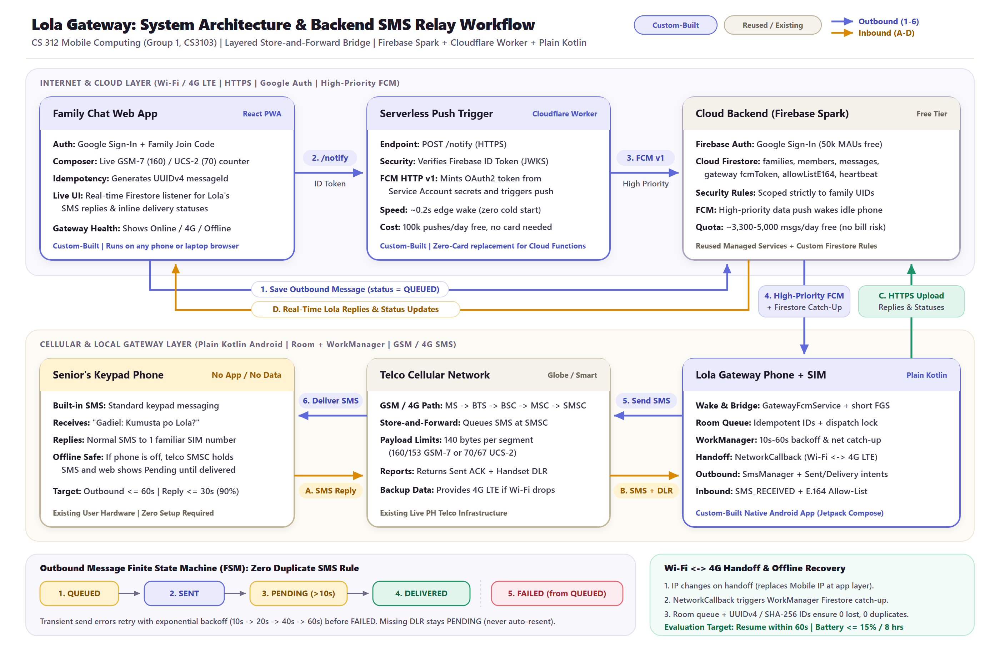
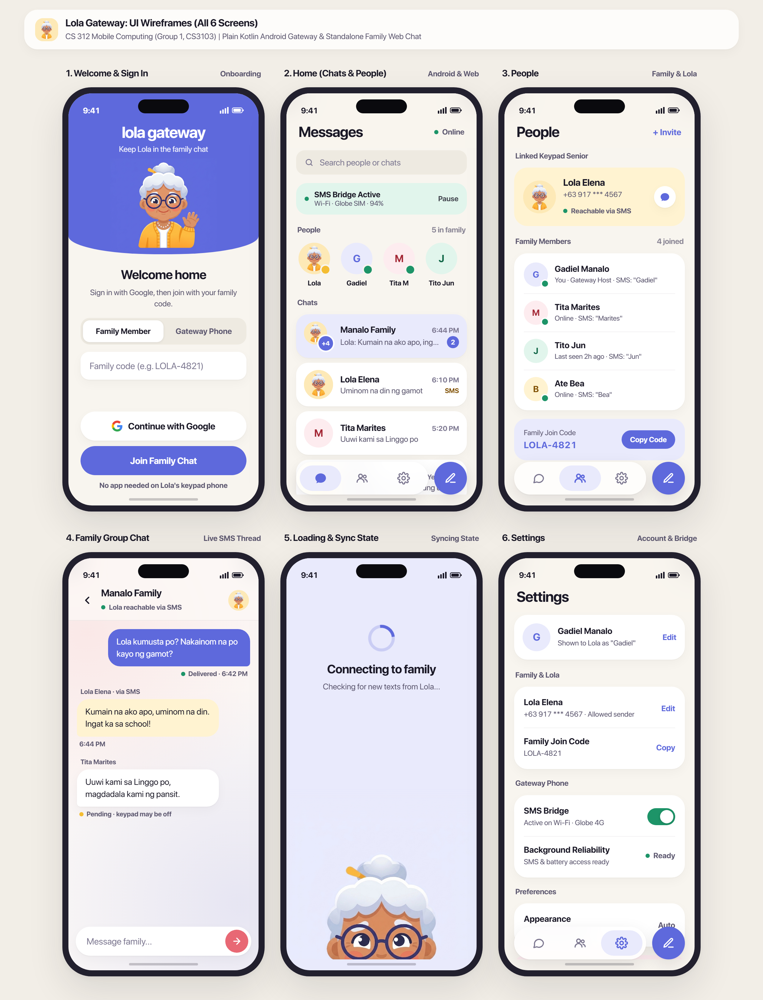
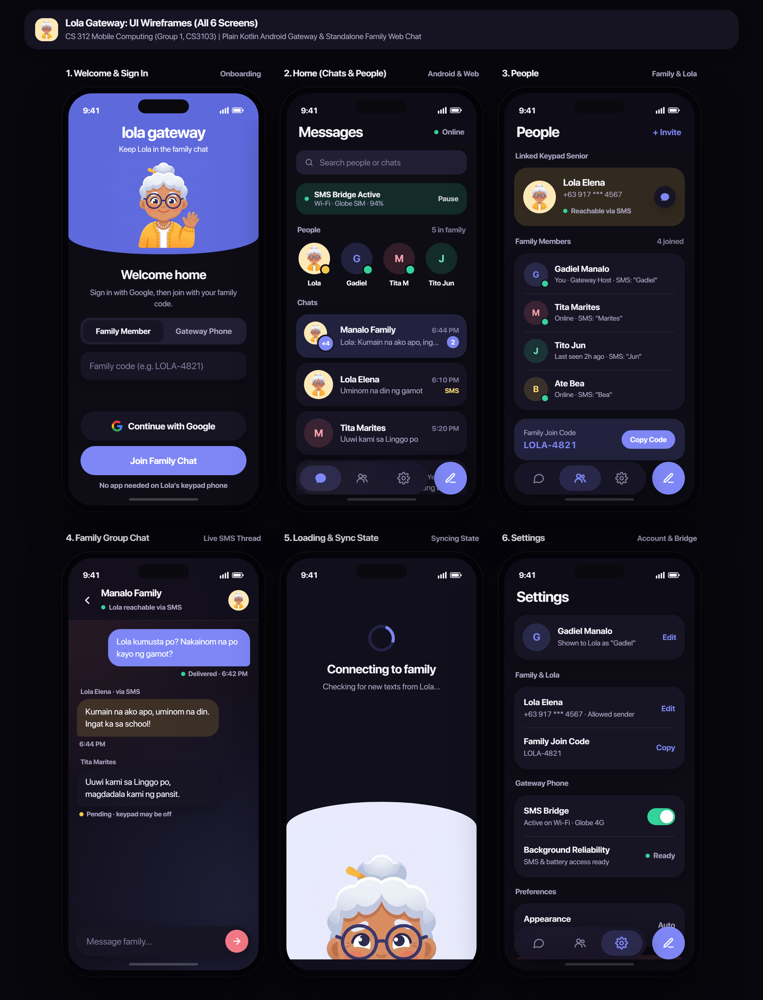

# Lola Gateway

**Lola Gateway** is a plain Kotlin Android SMS gateway and standalone family group chat (React PWA) built for **CS 312: Mobile Computing** (Group 1, CS3103, Batangas State University Alangilan).

It connects senior citizens using basic keypad phones (no smartphone, no app, no mobile data) to their family group chat over live cellular SMS with real-time delivery status tracking, offline queueing, and Wi-Fi to 4G LTE handoff recovery.

## Team
- **Gadiel Gospel L. Manalo** - Lead Full Stack Developer (Plain Kotlin Android Gateway, SMS Engine, Room/WorkManager, Firebase + Cloudflare Worker Push)
- **Sebastian Miguel A. Bueno** - Full Stack Developer (React PWA Family Web Chat, Firestore Security Rules, Documentation)
- **Jyvhan Earl D. Ponce** - Quality Assurance (Test Plan, Latency/Handoff/Status/Battery Evaluation)

## Documents & Interactive UI
- **Step-by-Step Implementation Plan:** [`docs/superpowers/plans/2026-11-20-lola-gateway.md`](docs/superpowers/plans/2026-11-20-lola-gateway.md)
- **Team Distribution & Git Workflow:** [`docs/TEAM_DISTRIBUTION.md`](docs/TEAM_DISTRIBUTION.md)
- **Full Design Spec:** [`docs/superpowers/specs/2026-11-20-lola-gateway-design.md`](docs/superpowers/specs/2026-11-20-lola-gateway-design.md)
- **Interactive UI Wireframes (6 Screens, Light & Dark):** [`docs/ui/lola-gateway-wireframes.html`](docs/ui/lola-gateway-wireframes.html)
- **Editable Architecture Diagram (SVG):** [`docs/diagrams/lola-gateway-backend-workflow.svg`](docs/diagrams/lola-gateway-backend-workflow.svg)

## Backend Architecture & SMS Relay Workflow

## UI Wireframes (Light Cream & Dark Twilight)

