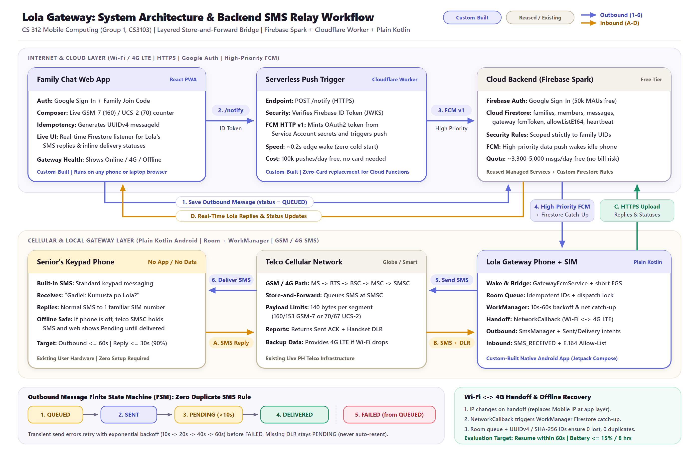
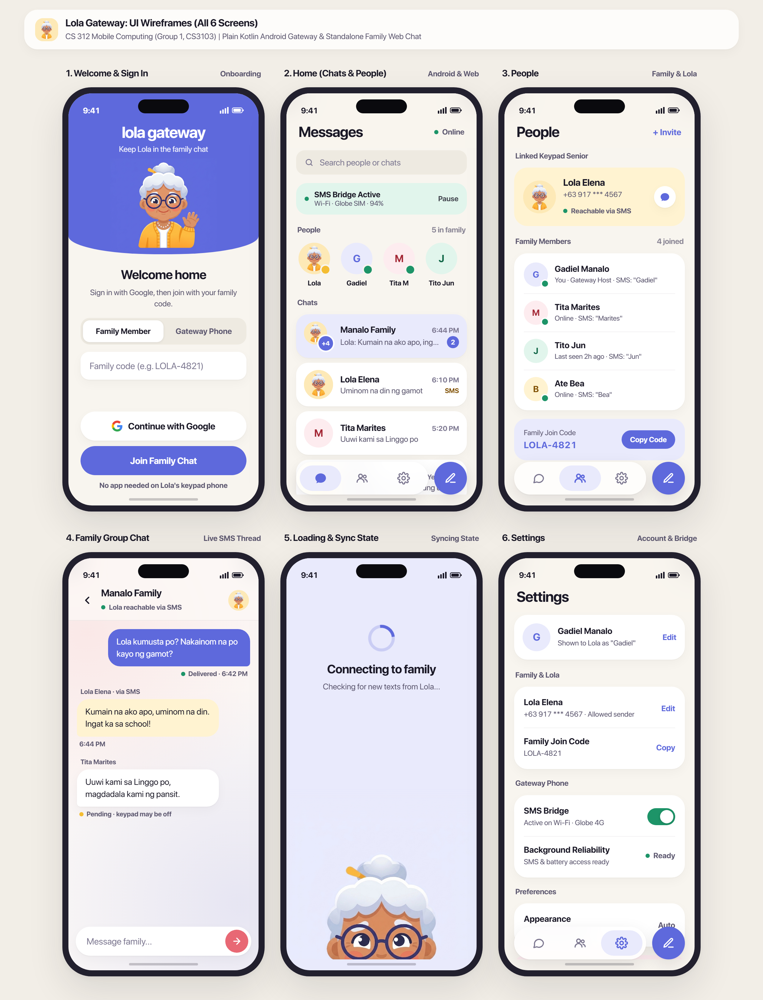

# Design Spec: Lola Gateway (Android SMS Gateway & Family Group Chat)

**App & Repository Name:** `Lola Gateway` (`github.com/manalogadiel/lola-gateway`, Android package `dev.lolagateway`)
**Course & Team:** CS 312 Mobile Computing (CS3103, Group 1, Batangas State University Alangilan)
- **Gadiel Gospel L. Manalo** (Lead Full Stack Developer): Plain Kotlin Android Gateway app, SMS engine, Room/WorkManager reliability, Firebase + Cloudflare Worker push trigger, integration, final demo
- **Sebastian Miguel A. Bueno** (Full Stack Developer): Standalone React PWA family web chat, Firestore security rules, final documentation
- **Jyvhan Earl D. Ponce** (Quality Assurance): Test plan, feature QA, 100 outbound + 100 inbound trials across 2 telcos, 30 handoff/outage trials, 100 status accuracy checks, 8-hour battery test

**Target Demo Window:** November 30 to December 4, 2026

---

## 1. Intent & Why

Many Filipino families coordinate daily through group chats that require a smartphone, mobile data, and an app. Older adults using basic keypad phones are left out unless relatives manually relay messages by hand.

**Lola Gateway** bridges this gap with a standalone, zero-install solution for the senior:
1. Relatives chat inside a standalone browser-based **Family Chat Web App (React PWA)**.
2. A spare/household Android phone running the **Lola Gateway App (Plain Kotlin)** acts as a store-and-forward SMS bridge over Wi-Fi (with 4G LTE failover) and cellular SMS.
3. The senior receives messages prefixed with the relative's short name (`Gadiel: Kumusta po Lola?`) on their unmodified keypad phone and replies by normal SMS to one familiar number, which appears in real time inside the family chat.



---

## 2. Project Size & Approaches Considered

**Size:** Full multi-component academic prototype (Plain Kotlin Android Gateway + Cloudflare Worker + Firebase Spark + React PWA) tightly scoped to one family group, one Gateway phone, and one keypad phone.

### Approaches Considered

| Approach | Summary | Tradeoffs | Decision |
|---|---|---|---|
| **Approach 1 (Selected): Zero-Card A (Firebase Spark + Cloudflare Worker FCM HTTP v1) + Plain Kotlin Gateway + Standalone React PWA** | Auth (Google Sign-In), Firestore real-time storage, and FCM stay on Firebase's free Spark tier. A ~60-line Cloudflare Worker verifies Firebase ID tokens and calls Google's FCM HTTP v1 API to send high-priority pushes. | Requires deploying one tiny external Worker alongside Firebase rules. In return: **no billing card required**, guaranteed ₱0 cost (hard caps instead of surprise overages), faster cold starts (~0.2s vs 1.5 to 4s), 100k free pushes/day, and 100% identical Doze-safe FCM wakeups on Android (~3% to 8% battery over 8 hours). | **Selected** |
| **Approach 2: Firebase Blaze Plan (Cloud Functions v2 + Firestore + FCM)** | Uses Firebase Cloud Functions (`onDocumentCreated`) directly inside one Firebase project. | Matches original proposal wording 1-to-1, but requires linking a credit/debit card on Google Cloud and introduces Artifact Registry container image storage micro-charges (~₱2 to ₱15/mo) and loop-bug billing exposure. Porting from Approach 1 takes ~10 minutes with zero Kotlin changes if ever desired. | Rejected (billing card gate) |
| **Approach 3: Pure Firebase Spark (No FCM, Always-On Firestore Snapshot Listener in Foreground Service)** | Zero external serverless functions; the Android Gateway holds an open Firestore gRPC stream in a foreground service. | Android Doze suspends idle sockets after ~30 to 60 minutes (risking >60s outbound latency, failing R1), while holding wakelocks burns ~15% to 35% battery over 8 hours (risking the <=15% battery target). Also contradicts the proposal's Page 7 justification against always-open connections. | Rejected (Doze/battery risk) |

---

## 3. Goals, Non-Goals & Anti-Goals

### Goals (Aligned to CS 312 Part 5 Quantitative Targets)
- **R1 Outbound Latency:** Deliver web chat messages to the keypad phone as SMS within **60 seconds in >= 90% of 100 trials** (50 per telco across 2 PH telcos).
- **R2 Reply Latency:** Relay inbound keypad SMS replies to the family chat within **30 seconds in >= 90% of 100 trials** (50 per telco).
- **R3 Connectivity & Handoff Reliability:** Observe **0 lost and 0 duplicate messages in 30 trials** (10 Wi-Fi-to-4G switches, 10 Wi-Fi outages, 10 full internet outages), with delivery resuming within **60 seconds** of reconnection.
- **R4 Status Accuracy:** Display accurate `Queued`, `Sent`, `Pending`, `Delivered`, or `Failed` statuses in **100% of 100 trials** (including `Pending` when the keypad phone is off and `Failed` on an invalid number), reflected within **5 seconds** of the report.
- **Gateway Battery Efficiency:** Consume **<= 15% Android battery over 8 hours** unplugged with screen off and 50 relayed messages.
- **Friendly Messaging UX:** Present a warm, Apple-style messaging experience (cute Lola mascot, soft pastel Light Cream and Dark Twilight themes, messaging-first Home with People & Group Chats, no technical Queue tab, no QA clutter in user Settings).

### Non-Goals (Explicitly Out of Scope)
- Photos, voice notes, video, or voice calls (text-only SMS scope).
- Direct integration with personal Facebook Messenger, WhatsApp, or Viber chats (Meta's Messenger Platform targets Business Pages, not personal family chats).
- Multi-family / multi-tenant SaaS scaling or multiple simultaneous gateways per family.
- Emergency services support or Google Play Store publication (APK is sideloaded via `adb install`).
- Firebase Phone Auth (SMS OTP), which requires a Blaze billing card and caps free verification texts at 10/day.

### Anti-Goals (Failure Conditions)
- **Never duplicate SMS on missing delivery reports:** Once `SmsManager` submits an SMS to the telco SMSC (`RESULT_OK`), never automatically resend solely because `deliveryIntent` has not arrived; hold the message in `PENDING`.
- **Never store or leak non-allow-listed SMS content:** Inbound SMS from phone numbers outside `allowListE164` must be dropped immediately (optionally incrementing a blocked count only) to comply with the Philippine Data Privacy Act of 2012 (RA 10173).
- **Never commit secrets to Git:** Firebase Service Account private keys, `.dev.vars`, `.env`, and keystores stay strictly ignored by `.gitignore` (repository is public).
- **Never expose developer QA tools in normal user UI:** Test SMS and CSV trial exports stay hidden behind a 5-tap version gesture in Settings so normal users see a clean consumer app.

---

## 4. Constraints, Platform Rules & Visual Assets

### Verified Local Toolchain
- Android SDK Platforms 34, 35, 36, 37 and Build-Tools 34.0.0 to 36.0.0 (`C:\Users\Diel\AppData\Local\Android\Sdk`)
- `adb` platform-tools, OpenJDK 21 LTS, Node.js v24.22, npm 11.19, Firebase CLI

### Android 13 to 15+ Engineering Constraints
- **Sideload Permissions:** Install APK via `adb install` to avoid Android 13+ Restricted Settings blocks on `SEND_SMS` and `RECEIVE_SMS`.
- **Explicit `PendingIntent`s (Android 14+):** `SmsManager` `sentIntent` and `deliveryIntent` MUST use explicit intents targeting `SmsStatusReceiver` with `setPackage(context.packageName)` and unique per-part `requestCode` values.
- **Foreground Service Typing (Android 14/15+):** Use short-lived `FOREGROUND_SERVICE_REMOTE_MESSAGING` bursts triggered by high-priority FCM pushes (avoiding Android 15's 6-hour cap on `dataSync` foreground services) paired with a battery-optimization exemption prompt.
- **Android SMS Rate Throttle:** Stock Android prompts/throttles past 30 outgoing SMS per 30 minutes. Enforce a default **2-second gap** between sequential sends in `SmsSender`. During formal 100-trial benchmark runs, document the default OS limit and optionally raise `sms_outgoing_check_max_count` via `adb` on the dedicated QA test phone.

### Philippine Telco & Hardware Constraints
- **Day 1 Smoke Test Mandatory:** Before wiring the full status pipeline, test 5 live SMS from the Gateway Android phone to the physical keypad phone (handset ON vs OFF) across both test SIMs (e.g., Globe + Smart) to observe real `deliveryIntent` (TP-SRR) behavior and verify active cellular reception amidst NTC 2G/3G decommissioning.
- **Real Operating Cost:** Cloud infrastructure is ₱0 (Spark + Cloudflare Worker). The only recurring cost is prepaid SIM text promo load (~₱50 to ₱100 for 200+ live SMS trials) plus light prepaid data on the Gateway SIM for 4G failover tests.

### Bundled Visual Assets (`docs/ui/assets/`)
- `lola-welcome.jpg` (1024x1024, `#5E69DC` background): Waving Lola mascot for Onboarding canopy.
- `lola-avatar.jpg` (1024x1024, `#FDE9B6` background): Smiling Lola portrait for circular avatars across Home, People, and Chat header.
- `lola-peeking.jpg` (1024x1024, `#E9EAFC` background): Peeking Lola illustration for Connecting / Sync loading states.

---

## 5. Locked UI & Interaction Design Specification

Interactive 6-screen wireframe reference: [`docs/ui/lola-gateway-wireframes.html`](../../ui/lola-gateway-wireframes.html)



### 5.1 Brand & Design Tokens
- **Identity:** Warm, approachable Filipino household messaging app centered around a friendly Lola mascot and Apple HIG principles (purpose, simplicity, craft, fluid critically-damped motion).
- **Themes (follows device system setting, both modes first-class):**
  - **Light Cream:** Canvas `#F8F5EF`, elevated surface `#FFFFFF`, soft fill `#EEEAE1`, primary ink `#1A1826`, secondary ink `#5B566E`.
  - **Dark Twilight:** Canvas `#0E0D16`, elevated surface `#171524`, soft fill `#221F34`, primary ink `#F5F3FA`, secondary ink `#ABA5C2`.
- **Palette (derived from user moodboard references):**
  - Primary Brand Accent (Soft Periwinkle): `#5E69DC` light / `#7E87F5` dark
  - Lola SMS Accent (Sunny Marigold): `#FFF3D1` bubble + `#7F4F00` ink light / `rgba(245,200,75,0.16)` + `#FAD975` dark
  - Send / Warm Action Accent (Coral Rose): `#E86874` light / `#F27986` dark
  - Live Status Accent (Sage Mint): `#1D9468` light / `#34D399` dark
- **Surface & Control Discipline:**
  - **Borderless elevated cards, search bars, and chat bubbles** (zero heavy grey card borders).
  - **Seamless unified top chrome:** Status bar and navigation bar share one continuous translucent surface extending cleanly to the top edge of the screen.
  - **Status indicators:** Strictly a clean colored `7px` dot + plain text (`Online`, `4G Backup`, `Delivered`, `Pending`), never wrapped in glowing pill badges.
  - **Navigation Shell:** Translucent floating **icon-only** bottom dock with **3 tabs (Chats, People, Settings)** and a circular **Compose** button positioned on the **right** side. **No Queue tab.**
  - **Motion & Typography:** SF Pro-inspired system geometric sans (`tabular-nums` on timestamps, phone numbers, battery, and SMS segment counters), press feedback `scale(0.96)` in `150ms ease-out`, `prefers-reduced-motion` respected.

### 5.2 Core Screens (6 Screens)
1. **Welcome & Sign In:** Curved `#5E69DC` canopy with waving Lola (`lola-welcome.jpg`), **Family Member / Gateway Phone** role switch, single-field Join Code (or Lola's phone number on Gateway setup), and `Continue with Google` + primary filled pill CTA.
2. **Home (Messages):** Messaging-app-first home screen with borderless search bar, compact tap-to-pause **SMS Bridge Active** strip (shown on Gateway phone only), horizontal **People** avatar row starting with Lola, and **Chats** list (`Manalo Family` group chat with stacked avatar + direct threads).
3. **People:** Pinned warm marigold **Linked Keypad Senior** card (`Lola Elena`, phone number, `Reachable via SMS`, direct message button), grouped **Family Members** list showing online presence and each member's SMS prefix nickname (`SMS: "Gadiel"`), and a copyable **Family Join Code** card.
4. **Family Group Chat:** Unified frosted header (bare `<` back chevron, family name, `Lola reachable via SMS` dot, Lola avatar), subtle warm blush-lavender chat backdrop, periwinkle self bubbles, white relative bubbles, sunny marigold `Lola · via SMS` bubbles, inline delivery statuses (`Queued`, `Sent`, `Pending`, `Delivered`, `Failed · Tap to retry`) directly below messages, and an uncluttered composer whose `GSM-7 / UCS-2` segment meter stays hidden until the user starts typing.
5. **Loading & Sync State:** Calm centered progress ring (`Connecting to family`) with the peeking Lola illustration (`lola-peeking.jpg`) framed seamlessly at the bottom (adapting cleanly in Dark Mode inside a curved pastel arch).
6. **Settings:** Strictly user-focused grouped settings: Google profile & SMS nickname, Lola's number & allow-list, Family Join Code with copy action, Gateway Phone `SMS Bridge` toggle + background permission readiness, Appearance (`Auto / Light / Dark`), and `Sign Out`. Hidden QA diagnostics (Test SMS + CSV log export for CS 312 evaluation) unlock only after tapping the app version footer 5 times.

---

## 6. System Architecture, Data Model & Reliability Contract

### 6.1 Authentication & Family Pairing (Gateway-First)
- Both apps authenticate via **Firebase Auth (Google Sign-In)**, free up to 50,000 MAUs on Spark.
- **Gateway-First Initialization:**
  1. Household host signs in with Google on the Kotlin Gateway app, enters `familyName`, `seniorName`, and `seniorPhone` (normalized to `+639XXXXXXXXX`).
  2. App creates `families/{familyId}` with a 6-8 character `joinCode` (e.g., `LOLA-4821`), registers the host under `members/{uid}` (`role = "GATEWAY"`), caches the allow-list locally in DataStore/Room, and saves `gateway.fcmToken`.
  3. Relatives open the React PWA, sign in with Google, enter `joinCode` + optional short SMS nickname, and are added to `members/{uid}` (`role = "MEMBER"`).

### 6.2 Shared Firestore Schema
1. `families/{familyId}`
   - `name`: string
   - `joinCode`: string (indexed for join lookup via `joinCodes/{joinCode}` mapping doc -> `{ familyId }` so unauthenticated/new users never query all families)
   - `seniorName`: string
   - `seniorPhoneE164`: string (`+639XXXXXXXXX`)
   - `allowListE164`: string[]
   - `gateway`: map
     - `uid`: string (Firebase Auth UID of Gateway host)
     - `deviceId`: string
     - `fcmToken`: string
     - `status`: `"ONLINE" | "OFFLINE" | "PAUSED"`
     - `networkType`: `"WIFI" | "CELLULAR" | "NONE"`
     - `carrierName`: string
     - `signalDbm`: int?
     - `batteryPercent`: int
     - `isCharging`: boolean
     - `lastHeartbeatAt`: Timestamp
2. `families/{familyId}/members/{uid}`
   - `displayName`: string
   - `smsNickname`: string (short prefix sent in SMS, e.g., `"Gadiel"`)
   - `role`: `"GATEWAY" | "MEMBER"` (Gateway host owns family/allow-list configuration)
   - `joinCode`: string (required when creating a `MEMBER` doc; must match `families/{familyId}.joinCode` and is immutable after creation; omitted on `GATEWAY` host docs)
   - `lastActiveAt`: Timestamp (updated on app open or message send; avoids persistent presence sockets)
   - `joinedAt`: Timestamp
3. `families/{familyId}/messages/{messageId}`
   - **Document ID (`messageId`):**
     - Outbound: client-generated `UUIDv4`
     - Inbound: deterministic `in_<sha256(senderE164 + "|" + smsTimestampMs + "|" + normalizedBody)>`
   - `direction`: `"OUTBOUND" | "INBOUND"`
   - `senderUid`: string (`"senior"` for inbound)
   - `senderName`: string
   - `text`: string
   - `smsFormattedText`: string (e.g., `"Gadiel: Kumusta po?"`)
   - `encoding`: `"GSM-7" | "UCS-2"`
   - `segmentCount`: int
   - `status`: `"QUEUED" | "SENT" | "PENDING" | "DELIVERED" | "FAILED"`
   - `retryCount`: int
   - `errorCode`: string? (`"NO_SERVICE"`, `"RADIO_OFF"`, `"GENERIC_FAILURE"`, `"INVALID_NUMBER"`)
   - `errorReason`: string?
   - `retryOfMessageId`: string? (set when a user retries a `FAILED` message by creating a new document)
   - `createdAt`: Timestamp
   - `queuedOnGatewayAt`: Timestamp?
   - `sentAt`: Timestamp?
   - `deliveredAt`: Timestamp?
   - `statusUpdatedAt`: Timestamp
   - `gatewayNetworkAtSend`: `"WIFI" | "CELLULAR"`?
4. `users/{uid}` -> `{ familyId, updatedAt }`
   - One family pointer per Firebase Auth account; both fields are required and no additional fields are allowed.
   - `familyId`: non-empty string identifying the family to recover when local storage is empty.
   - `updatedAt`: Timestamp, set by the server when web chat saves the pointer.
   - Web chat saves the pointer in the same batch as joining or rejoining. Existing members backfill after their cached family is verified, without overwriting an existing pointer. Members who cleared their storage before a pointer was saved enter the join code once to establish it. Android Gateway recovery is a follow-up.

### 6.3 Cloudflare Worker Push Trigger (`worker/`)
- **Endpoint:** `POST /notify` with `Authorization: Bearer <Firebase ID Token>` and JSON body `{ "familyId": "...", "messageId": "..." }`.
- **Verification & Execution:**
  1. Verifies the Firebase ID token signature, `aud`, `iss`, and `exp` against Google's public JWKS certificates (cached in Worker memory).
  2. Checks caller membership in `families/{familyId}/members/{uid}` and reads `families/{familyId}.gateway.fcmToken` via Firestore REST API using a short-lived OAuth2 token minted from Service Account secrets (`FIREBASE_PROJECT_ID`, `FIREBASE_CLIENT_EMAIL`, `FIREBASE_PRIVATE_KEY`) stored via `wrangler secret put`.
  3. Sends a **data-only high-priority FCM HTTP v1** payload (`android.priority = "HIGH"`, `data = { familyId, messageId }`) to wake the Android Gateway even in Doze mode.
- **Resilience:** If the browser closes before `/notify` succeeds, the Gateway's `NetworkMonitor` / periodic `WorkManager` Firestore catch-up still pulls the `QUEUED` message safely.

### 6.4 Outbound Message FSM & Anti-Duplicate SMS Rules
- **Canonical States:** `QUEUED` -> `SENT` -> `PENDING` (after 10s grace window with no DLR) -> `DELIVERED`, or `QUEUED` -> `FAILED`.
- **Local Atomic Claim Lock (Room):** Room table `local_messages` stores `localDispatchState` (`READY | DISPATCHING | DISPATCHED | TERMINAL`) alongside `messageId` as `PRIMARY KEY` (`OnConflictStrategy.IGNORE`). A single-threaded sequential dispatcher claims one `READY` message inside a Room `@Transaction` before calling `SmsManager`.
- **Multipart SMS Tracking:** Compute parts with `SmsManager.divideMessage(smsFormattedText)` and `SmsMessage.calculateLength(smsFormattedText, false)` (160/153 GSM-7, 70/67 UCS-2). Track per-part `sentOk` and `deliveredOk` in `local_sms_parts`; advance parent status to `SENT` or `DELIVERED` only when all parts confirm (`Activity.RESULT_OK` / DLR TP-Status `0x00`).
- **Retry Policy:**
  - Transient send errors (`RESULT_ERROR_NO_SERVICE`, `RESULT_ERROR_RADIO_OFF`, `RESULT_ERROR_GENERIC_FAILURE`): retry with exponential backoff (**10s -> 20s -> 40s -> 60s**, max 4 attempts) before marking `FAILED`.
  - Permanent errors (malformed/invalid E.164 number, empty payload): mark `FAILED` immediately.
  - Missing delivery report after `RESULT_OK`: transition `SENT -> PENDING` after 10s via `PendingStatusWorker`; **never auto-resend**.

### 6.5 Inbound SMS Flow & Privacy Guard
1. Manifest-declared `SmsInboundReceiver` captures `Telephony.Sms.Intents.SMS_RECEIVED_ACTION`.
2. Reassembles multipart PDUs per originating address from `getMessagesFromIntent(intent)`.
3. Normalizes originating address to PH E.164 (`09...`, `9...`, `639...`, `+639...` -> `+639XXXXXXXXX`).
4. Checks cached local `allowListE164`. If unmatched, drops payload immediately without storing message text.
5. Inserts deterministic `in_<sha256>` row into Room (`syncState = PENDING_UPLOAD`) and schedules `SyncEngineWorker` (`NetworkType.CONNECTED`) to idempotently upsert into Firestore (`status = "DELIVERED"`).

### 6.6 Connectivity Handoff & Offline Recovery (Replacing Mobile IP)
- `NetworkMonitor` listens to `ConnectivityManager.registerDefaultNetworkCallback`.
- On any transport transition (`WIFI` <-> `CELLULAR`) or recovery from `NONE`:
  1. Records handoff entry in Room `handoff_logs` (old transport, new transport, transition timestamp, recovery completion timestamp) for QA evaluation.
  2. Immediately enqueues unique `SyncEngineWorker` (`NetworkType.CONNECTED`):
     - Pulls any `QUEUED` outbound messages from Firestore not yet in Room.
     - Uploads all dirty status transitions and unsynced inbound replies to Firestore.
     - Publishes fresh Gateway heartbeat (`networkType`, `batteryPercent`, `isCharging`, `lastHeartbeatAt`).

### 6.7 Firestore Security Rules (`firebase/firestore.rules`)
- Default deny all.
- `joinCodes/{code}`: authenticated users can `get` (not `list`) a specific code to resolve `familyId`.
- `users/{uid}`: only the signed-in owner (`request.auth.uid == uid`) can `get`, `create`, `update`, or `delete` their pointer; `list` is denied.
  - `create` and `update` require exactly `['familyId', 'updatedAt']`, a non-empty string `familyId`, and a timestamp `updatedAt`.
  - `isFamilyParticipantAfter(familyId)` verifies membership or Gateway ownership after the write, allowing a join or future Android Gateway setup to include the pointer in the same batch. The pointer itself does not grant family access.
- `families/{familyId}`: readable by verified `members/{request.auth.uid}`; writable (`gateway` fields, `allowListE164`, `seniorPhoneE164`, `seniorName`, `name`) strictly by `families/{familyId}.gateway.uid`.
- `families/{familyId}/members/{uid}`:
  - `create` (`MEMBER`): authenticated user (`request.auth.uid == uid`) must include `joinCode` matching `families/{familyId}.joinCode`.
  - `create` (`GATEWAY`): strictly restricted to `families/{familyId}.gateway.uid` (no `joinCode` field required).
  - `update`: own doc only (`displayName`, `smsNickname`, `lastActiveAt`); `role`, `joinedAt`, and `joinCode` stay immutable.
- `families/{familyId}/messages/{messageId}`:
  - `read`: any verified family member.
  - `create` (`OUTBOUND`): any verified family member where `senderUid == request.auth.uid` and `status == "QUEUED"`.
  - `create` (`INBOUND`) and `update` (status/timestamp fields): strictly restricted to the Gateway UID (`families/{familyId}.gateway.uid`).

### 6.8 Settled Builder Calls (From Pre-Plan Review)
- **Paused Bridge Behavior (Builder Call):** Pausing the bridge holds outbound messages in `QUEUED` (never marks them `FAILED`) and holds inbound SMS locally in Room until resumed, at which point `SyncEngineWorker` drains both directions automatically. The Cloudflare Worker skips waking a `PAUSED` gateway.
- **`Failed · Tap to retry` Contract (Builder Call):** Retrying a `FAILED` message creates a new `messages/{newUuid}` document (referencing `retryOfMessageId`) instead of mutating the failed doc in place, keeping Firestore update rules strictly Gateway-only and Room's `messageId` dispatch lock immutable.
- **Offline Detection & Member Activity (Builder Call):** No Realtime Database sockets (protects 8-hour Doze battery). Gateway writes `lastHeartbeatAt` every 15 min via `WorkManager` and immediately on state/network transitions; the web app shows `Gateway Offline` if `lastHeartbeatAt` is >20 min stale (or immediately when `PAUSED`). Family member activity uses `members/{uid}.lastActiveAt` updated on open/send.
- **Background Web Push (Builder Call):** Out of scope for MVP (live Firestore updates while the web chat is open, no separate web-push fan-out worker).
- **Dual-SIM Safety (Builder Call):** Request `READ_PHONE_STATE` and use `SubscriptionManager` + `SmsManager.createForSubscriptionId(subId)` so Dual-SIM test phones let the host pick SIM 1 or SIM 2 explicitly without triggering Android's interactive SIM prompt.
- **QA Invalid-Number & Browser Latency Logging (Builder Call):** Hidden 5-tap Diagnostics on Android includes a one-off QA test send (allowing an invalid destination override without corrupting `seniorPhoneE164`) plus Room CSV export; React PWA supports an optional hidden `?qa=1` query flag to export browser send/render timestamps for R1/R2/R4 verification.

### 6.9 Scope Defaults Locked for Implementation Plan (Override Anytime)
1. **Single Shared Family Group Chat (Default Locked):** Matches the CS 312 proposal scope (`one family chat linked to one Gateway Android phone and one keypad phone`). Home and People show Lola and family members; tapping Lola, the family group, or Compose opens that shared SMS-linked chat cleanly without extra DM subcollections.
2. **Android App = Gateway Phone + Host Chat (Default Locked):** The plain Kotlin Android app runs on the household Gateway phone (with full messaging UI so the host can read and send directly, dispatching locally without an FCM self-push), while relatives use the standalone React PWA in any browser.

---

## 7. Plain Kotlin Android & Monorepo Architecture

**Kotlin Stack:** 100% Kotlin, Jetpack Compose + Material 3, Room (KSP), WorkManager, DataStore Preferences, Firebase BoM (Auth, Firestore, Messaging), Android Credential Manager (Google Sign-In), Kotlin Coroutines. Manual `AppContainer` DI (zero Hilt/KAPT overhead).
**SDK Targets:** `minSdk = 26`, `compileSdk = 35`, `targetSdk = 35`.

```text
lola-gateway/
├── android-gateway/                  # Plain Kotlin Android App (Manalo)
│   └── app/src/main/java/dev/lolagateway/
│       ├── LolaGatewayApp.kt         # AppContainer + Notification channels
│       ├── MainActivity.kt           # Single-activity Compose host
│       ├── data/
│       │   ├── local/                # Room DB (local_messages, local_sms_parts, handoff_logs), DAOs, PrefsStore
│       │   ├── remote/               # FirestoreGatewayRepo, HeartbeatManager
│       │   └── model/                # MessageStatus, PhoneNormalizer, SmsSegmentCalculator
│       ├── sms/
│       │   ├── SmsSender.kt          # SmsManager multipart + explicit PendingIntents + 2s throttle
│       │   ├── SmsStatusReceiver.kt  # Manifest BroadcastReceiver (SMS_SENT, SMS_DELIVERED)
│       │   ├── SmsInboundReceiver.kt # Manifest BroadcastReceiver (SMS_RECEIVED + E.164 allow-list)
│       │   └── PendingStatusWorker.kt# Transitions SENT -> PENDING after 10s without DLR
│       ├── sync/
│       │   ├── GatewayFcmService.kt  # High-priority FCM wake -> short FGS / WorkManager
│       │   ├── GatewayBurstService.kt# Short-lived remoteMessaging FGS for reliable processing
│       │   ├── SyncEngineWorker.kt   # Outbound drain + Inbound upload + Firestore catch-up
│       │   └── NetworkMonitor.kt     # Wi-Fi <-> 4G handoff detector + recovery trigger
│       ├── diagnostics/
│       │   └── CsvLogExporter.kt     # Hidden (5-tap version) QA CSV export for CS 312 trials
│       └── ui/
│           ├── theme/                # Light Cream / Dark Twilight tokens, typography, motion
│           ├── components/           # StatusDot, IconBottomDock, BridgeStrip, LolaMascot
│           ├── onboarding/           # Welcome canopy, Google Sign-In, Gateway setup & permissions
│           ├── home/                 # Messaging Home (Search, People strip, Group Chats, Bridge bar)
│           ├── people/               # Linked Senior card, Family Members roster, Join Code card
│           ├── chat/                 # Live Family Chat + inline statuses + auto-show SMS meter
│           ├── loading/              # Peeking Lola syncing screen
│           └── settings/             # Clean user Settings + hidden 5-tap QA diagnostics sheet
├── worker/                           # Cloudflare Worker (Zero-Card FCM HTTP v1 trigger)
├── firebase/                         # firestore.rules, firestore.indexes.json (Spark tier)
├── web-chat/                         # Standalone React + Vite PWA for family members (Bueno)
└── docs/
    ├── superpowers/specs/            # Formal design specifications
    ├── superpowers/plans/            # Bite-sized TDD implementation plans
    ├── ui/                           # Interactive 6-screen wireframe HTML + Lola mascot assets
    └── diagrams/                     # Editable SVG + print-ready PNG architecture diagrams
```

---

## 8. Compressed Schedule & Evaluation Plan (Nov 20 to Dec 4)

- **Nov 20-21 (Hardware Gate):** Verify Android Gateway phone, keypad phone local cellular reception, 2 PH SIMs with text promos + prepaid data; run 5-SMS live DLR smoke test (keypad ON vs OFF); provision Firebase Spark + Cloudflare Worker.
- **Nov 21-24 (Vertical MVP Build):** Scaffold monorepo, build Kotlin SMS engine + Room/WorkManager/FCM/NetworkMonitor + 6 Compose screens, deploy Cloudflare Worker + Firestore rules, and build React PWA Family Chat.
- **Nov 25-26 (Integration & Handoff Testing):** Full end-to-end Web -> Worker -> FCM -> Gateway -> Keypad -> Gateway -> Web round-trip + Wi-Fi/4G handoff verification.
- **Nov 27-30 (CS 312 Part 5 Evaluation):** Execute 100 outbound trials (50/telco), 100 reply trials (50/telco), 30 handoff/outage trials, 100 status accuracy checks, and 8-hour screen-off battery test; export CSV metrics via hidden diagnostics tool.
- **Nov 30-Dec 4 (Polish & Final Demo):** Fix any defects found in QA, compile evaluation tables into final documentation (using updated `Lola Gateway` diagrams), and run final demonstration.

---

## 9. Left to the Builder

The items below are intentionally left open to the implementer unless specified otherwise during planning:
- Exact Gradle Kotlin/Compose BOM minor patch versions compatible with Android SDK 35 and JDK 21.
- Internal Room migration/versioning strategy during local dev (`fallbackToDestructiveMigration` acceptable pre-demo).
- Exact Firestore REST helper implementation inside the Cloudflare Worker (Web Crypto RS256 JWT signing with zero Node polyfills).
- Unit test fixtures and fake/mock interfaces (`SmsTransport`, `GatewayCloudClient`) so JVM tests run cleanly without physical SIM hardware.
